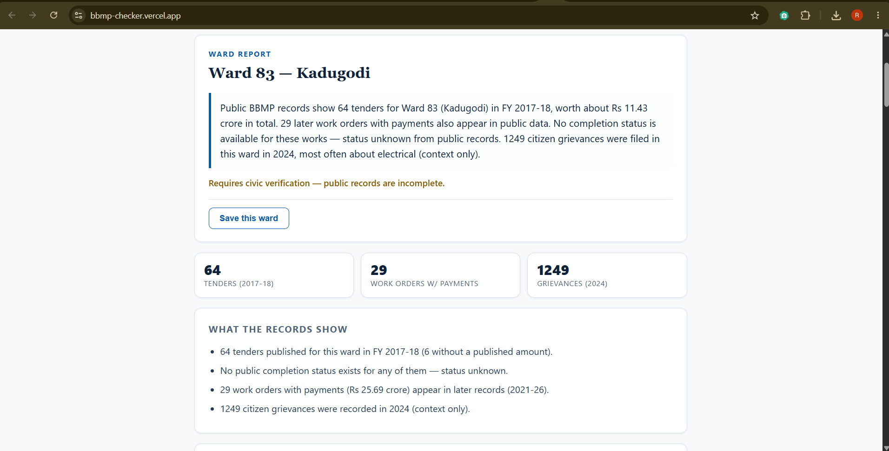

# WHOSE MONEY? — BBMP Ward Accountability Checker

**See what public BBMP records say about spending in your ward.**

**Live demo:** https://bbmp-checker.vercel.app
*(The backend runs on a free tier and sleeps when idle, so the very first search can take about 30 seconds.)*



A civic-tech project that turns scattered public BBMP datasets (tenders, work orders, grievances) into a plain-English, evidence-backed accountability report for any Bengaluru ward. Enter a ward number or locality and get what was tendered, for how much, and when. Just as importantly, it shows what the public record *doesn't* tell you.

> **Core principle:** the ward report is 100% public, with no login required. Authentication exists only for one optional convenience feature ("My Saved Wards"), and the app works fully with it disabled.

---

## What a citizen sees

Search **Ward 83 (Kadugodi)** and get:

- A **plain-English summary** ("Public BBMP records show 64 tenders for Ward 83 in FY 2017-18, worth about Rs 11.43 crore in total…")
- **Tendered works**: title, amount, published date, **tender closing date** (never mislabelled as a project deadline), tender number, category, source link
- **Status badges** that are honest: with no completion data in any public source, every project reads **NO COMPLETION INFORMATION** (gray). The app never fabricates a status.
- **Work orders with payments** (2021–26): contractor names, paid amounts, payment references
- **Citizen grievances** (2024): ward-wide counts and top categories, explicitly labelled *context only*
- **Findings and assessment** generated by transparent rules, e.g. *"Requires civic verification — public records are incomplete."*

## Tech stack

| Layer | Technology |
|---|---|
| Frontend | React + Vite |
| Backend | Python, FastAPI |
| Database | Supabase (PostgreSQL) with Row Level Security |
| Auth | Supabase magic-link (optional, saved wards only) |
| Hosting | Vercel (frontend), Render (backend) |
| Data | BBMP public datasets via OpenCity |

## Architecture

```
┌────────────────────────────────────────────────────────────────┐
│  React + Vite (Vercel)                                         │
│  search box → report cards → badges → evidence links           │
│  │  fetch /report (public)          │ supabase-js (anon key)   │
│  │                                  │  magic-link auth ONLY    │
│  │                                  │  for "My Saved Wards"    │
└──┼──────────────────────────────────┼──────────────────────────┘
   ▼                                  ▼
┌────────────────────────┐   ┌─────────────────────────────────┐
│  FastAPI (Render)      │   │  Supabase                       │
│  GET /report?ward=…    │   │  Postgres tables:               │
│  GET /health           │   │  wards, tenders, work_orders,   │
│                        │   │  complaints, evidence,          │
│  Pipeline (services/): │   │  investigations,                │
│                        │   │  saved_wards (RLS)              │
│  1 Collector  → query  │   │  Auth: auth.users               │
│  2 Checker    → status │   │                                 │
│  3 Complaint Analyzer  │   │  Data loaded ONCE by            │
│  4 Investigator→finding│   │  backend/ingestion/ingest.py    │
│  5 Explainer  → summary│   │  (no live scraping per search)  │
│    (deterministic;     │   │                                 │
│     optional LLM polish│   └─────────────────────────────────┘
│     with auto-fallback)│
└────────────────────────┘
```

**Design rule enforced everywhere:** missing data is shown as missing ("Status unknown — no public completion information was found"). A tender closing date is never presented as a completion deadline. Nothing is ever inferred about wrongdoing, only transparent indicators ("no completion status in public records", "N grievances recorded") that a citizen can verify via the linked sources.

## Data sources (all public, via OpenCity)

| Dataset | Used for | Loaded |
|---|---|---|
| [BBMP Tenders 2017-18](https://data.opencity.in/dataset/bbmp-tenders) | projects: title, amount, dates, tender number | 6,842 rows |
| [BBMP Work Orders & Payments 2025-26](https://data.opencity.in/dataset/bbmp-work-orders-and-payments-2025-26) | contractor, paid amount, payment ref | 4,702 rows |
| [BBMP Grievances 2024](https://data.opencity.in/dataset/bbmp-grievances-data) | ward complaint counts and categories | 197,057 rows |
| [BBMP Ward Information](https://data.opencity.in/dataset/bbmp-ward-information) | ward number ↔ name ↔ zone lookup | 198 rows |

Ward numbers are extracted from tender titles by regex (~72% have one). Grievance ward names are matched to numbers via normalization and fuzzy matching (~95% match rate); unresolvable names are skipped, never guessed.

## API

```
GET /report?ward=<number|name>     # e.g. 83, 183, Kamakshipalya
GET /health
```

Abridged response:

```json
{
  "ward": "83", "ward_name": "Kadugodi", "zone": "Mahadevapura",
  "projects": [ { "title": "...", "amount": 1494135.0,
                  "tender_last_date": "2017-04-20",
                  "status": "NO_COMPLETION_INFORMATION",
                  "finding": "No completion information found",
                  "evidence": [ { "source": "OpenCity BBMP Tenders 2017-18",
                                  "source_url": "https://data.opencity.in/dataset/bbmp-tenders" } ] } ],
  "work_orders": [ { "contractor": "...", "amount": 4995487.0 } ],
  "complaints": { "total": 1249, "top_categories": [ { "category": "...", "count": 300 } ] },
  "summary": "Public BBMP records show 64 tenders for Ward 83 ...",
  "assessment": "Requires civic verification — public records are incomplete."
}
```

A ward with no records returns `{"ward":"999","projects":[],"message":"No public records found for this ward."}` (HTTP 200, not an error). If the database is unreachable, the API returns HTTP 503 with a friendly message.

## Run it locally

**Prerequisites:** Python 3.11+ and Node 18+.

### 1. Supabase

1. Create a free project at [supabase.com](https://supabase.com).
2. In the SQL Editor, run `backend/ingestion/schema.sql` (creates the tables and indexes).
3. Optionally run `backend/ingestion/saved_wards.sql` (adds `saved_wards` with RLS, only needed for the saved-wards feature).
4. Under Project Settings → API, note the **Project URL**, the **anon** key, and the **service_role** key.
5. Under Authentication → Providers, make sure **Email** is enabled (magic links work out of the box).
6. Under Authentication → URL Configuration, set the Site URL and add your frontend URL to Redirect URLs.

### 2. Environment variables

Keys live only in `.env` files and are never committed. Copy the examples and fill them in:

```
# .env (project root, backend; service_role key — SERVER ONLY, never expose to the browser)
SUPABASE_URL=https://<your-project>.supabase.co
SUPABASE_SERVICE_KEY=<service_role key>

# frontend/.env (browser; anon key is safe for browsers because tables are RLS-protected)
VITE_API_URL=http://localhost:8000
VITE_SUPABASE_URL=https://<your-project>.supabase.co
VITE_SUPABASE_ANON_KEY=<anon key>
```

Without the two `VITE_SUPABASE_*` variables, the app disables auth and stays 100% public.

### 3. Install and load the data (one time)

```bash
python -m venv venv
venv\Scripts\activate          # Windows  (macOS/Linux: source venv/bin/activate)
pip install -r requirements.txt

python -m backend.ingestion.ingest --wards
python -m backend.ingestion.ingest --tenders
python -m backend.ingestion.ingest --work-orders
python -m backend.ingestion.ingest --complaints    # takes a few minutes
```

The source CSVs are not stored in this repo. Download them from OpenCity (links in the table above and in `backend/config.py`) and place them in a `data/` folder. The ingest script batches, retries on network failures, and is safe to re-run.

### 4. Start the app

```bash
# Terminal 1: backend (from project root)
python -m uvicorn backend.main:app --port 8000

# Terminal 2: frontend
cd frontend
npm install
npm run dev
```

Open http://localhost:5173. API docs are at http://localhost:8000/docs and the health check at http://localhost:8000/health.

## Deployment

- **Backend (Render):** Python web service. Build command `pip install -r requirements.txt`, start command `uvicorn backend.main:app --host 0.0.0.0 --port $PORT`. Environment variables: `SUPABASE_URL`, `SUPABASE_SERVICE_KEY`, `PYTHON_VERSION`.
- **Frontend (Vercel):** import the repo with Root Directory set to `frontend` (Vite preset). Environment variables: `VITE_API_URL` (the Render URL), `VITE_SUPABASE_URL`, `VITE_SUPABASE_ANON_KEY`.

## Security notes

- The `service_role` key exists only on the backend; the browser only ever receives the public anon key.
- Row Level Security is enabled on all tables. Data tables have no public policies, so the anon key cannot read or write them; the backend reads them with the service key. `saved_wards` has per-user policies so each person sees only their own rows.
- No secrets are committed (`.env` files are git-ignored; only `.env.example` files are tracked).

## Honest limitations

- **Data vintage:** tenders are FY 2017-18 (the latest complete year in the OpenCity tender dataset), work orders cover 2021-26 payments, and grievances are 2024. The eras don't overlap, so there is no reliable row-level join between a tender and its work order.
- **No completion status exists** in any loaded source, so every project shows NO COMPLETION INFORMATION. This is the finding, not a bug.
- **Ward boundaries changed** (198 → 243 → 225 wards). Grievances use newer ward names; about 5% could not be mapped to old ward numbers and are excluded, never guessed.
- **About 72% of tenders** have an extractable ward number; the rest (mostly services) are stored with no ward and are not searchable by ward.
- Ward search matches the official 198-ward list, so colloquial locality names may miss.
- The LLM-written summary is optional and currently disabled; deterministic summaries are the default.

## Future improvements

- Ingest all five tender years (2013-18) for spending-over-time trends per ward
- Join tenders to work orders via title similarity and amount proximity scoring
- Map the new 225-ward regime for full grievance coverage
- Kannada language toggle for accessibility
- Shareable deep links per project (e.g. `/report/83#tender-25412`)
- Scheduled re-ingestion as the upstream datasets are updated

See [DEMO.md](DEMO.md) for a 2-minute walkthrough script.

---

*Data: BBMP via data.opencity.in (public domain). This tool does not assert wrongdoing by any individual or entity; it surfaces what public records do and do not say.*
